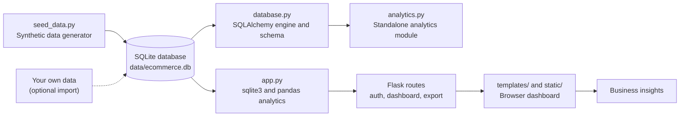
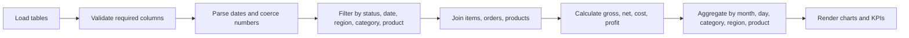
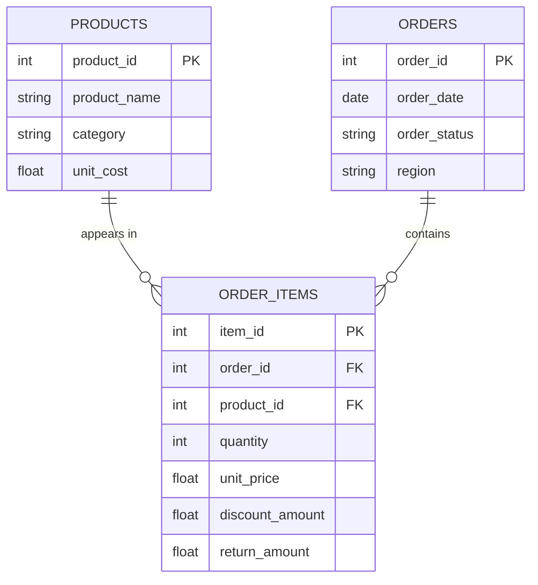

<div align="center">

# E-Commerce Business Intelligence Dashboard

### *Turning raw order data into clear, decision-ready business insight.*

<br/>


<br/>

[Overview](#project-overview) · [Features](#key-features) · [Architecture](#system-architecture) · [Setup](#installation-and-setup) · [Schema](#data-model-and-schema) · [Roadmap](#future-enhancements)

</div>

---

## Table of Contents

1. [Project Overview](#project-overview)
2. [Business Problem](#business-problem)
3. [Project Vision](#project-vision)
4. [Key Features](#key-features)
5. [KPI Framework](#kpi-framework)
6. [System Architecture](#system-architecture)
7. [Data Analytics Workflow](#data-analytics-workflow)
8. [Technology Stack](#technology-stack)
9. [Repository Structure](#repository-structure)
10. [Installation and Setup](#installation-and-setup)
11. [Configuration](#configuration)
12. [Running the Application](#running-the-application)
13. [Using the Dashboard](#using-the-dashboard)
14. [Dashboard Screenshots](#dashboard-screenshots)
15. [Business Questions Answered](#business-questions-answered)
16. [Insights and Recommendations](#insights-and-recommendations)
17. [Data Model and Schema](#data-model-and-schema)
18. [Testing and Validation](#testing-and-validation)
19. [Challenges and Solutions](#challenges-and-solutions)
20. [Limitations](#limitations)
21. [Future Enhancements](#future-enhancements)
22. [Contributing](#contributing)
23. [License](#license)
24. [About the Developer](#about-the-developer)
25. [Contact and Connect](#contact-and-connect)

---

## Project Overview

The **E-Commerce Business Intelligence Dashboard** is a Python and Flask web application that analyzes sales performance, revenue trends, and product performance from relational order data. Users sign in, choose a date range and optional category, region, or product filters, and review KPI summaries and chart-ready aggregations in the browser. Filtered data can also be exported to CSV.

**Why e-commerce analytics matters.** Online businesses generate a constant stream of orders, discounts, returns, and fulfilment events. Without a consistent view of that data, it is hard to answer basic questions: Is revenue growing? Which categories carry the business? Where are returns eroding margin? A BI dashboard turns those records into a small set of trusted metrics that a decision-maker can read in minutes.

**What this project demonstrates:**

- Designing a normalized relational schema (`products`, `orders`, `order_items`) with foreign keys, check constraints, and indexes.
- Building an analytics layer with `pandas`: joins, type coercion, filtering, grouping, and KPI calculation.
- Defining business metrics explicitly (gross sales, net sales, average order value) and applying them consistently.
- Shipping a working web application with authentication, CSRF protection, input validation, and CSV export.

> **Data note:** the repository includes a script that generates **synthetic demonstration data**. Any numbers you see after running it describe that sample, not a real business.

---

## Business Problem

Teams running an online store commonly face these challenges:

| Challenge | Why it hurts |
|---|---|
| Hard to monitor sales performance | Decisions rely on instinct instead of evidence. |
| Limited visibility into revenue trends | Seasonal dips and growth periods go unnoticed. |
| Unclear product and category contribution | Inventory and marketing spend are poorly allocated. |
| Discounts and returns buried in raw tables | Reported revenue overstates real revenue. |
| Order status mixed into sales totals | Cancelled and pending orders inflate results. |
| Data scattered across disconnected tables | Every report needs manual joining and cleaning. |

This dashboard addresses them by joining orders, line items, and products into one analytical view, excluding non-eligible orders from sales totals, subtracting discounts and returns to produce net sales, and exposing the result through filters and charts.

*Intended business applications are described above; what the code actually implements is listed in [Key Features](#key-features).*

---

## Project Vision

To provide a small, understandable, and extensible BI foundation: clean schema, transparent KPI logic, and a dashboard that a non-technical stakeholder can use. The long-term direction is a more complete analytics product (see [Future Enhancements](#future-enhancements)), built step by step on verified, well-documented metrics.

---

## Key Features

All features below were verified in the source code (`app.py`, `analytics.py`, `database.py`, `seed_data.py`).

| Feature | Purpose | Business value |
|---|---|---|
| **KPI summary** | Gross sales, net sales, order count, average order value, estimated cost, estimated profit, profit margin | One-glance health check of the business. |
| **Monthly sales trend** | Net sales and distinct orders per month | Reveals growth and seasonality. |
| **Daily sales view** | Net sales for the most recent 31 days in the selection | Short-term performance monitoring. |
| **Category performance** | Net sales and units sold per category | Shows which categories carry revenue. |
| **Regional performance** | Net sales and orders per region | Highlights geographic concentration. |
| **Top 10 products** | Highest net-sales products with category and units | Guides stocking and promotion. |
| **Order status breakdown** | Order counts by status | Surfaces cancellation and pending rates. |
| **Category profitability** | Net sales, estimated cost, and estimated profit per category | Margin awareness (requires `unit_cost` data, see [Limitations](#limitations)). |
| **Simple sales projection** | Next three months projected from the average of the last three months | A baseline reference, not a statistical forecast. |
| **Interactive filters** | Date range, category, region, and product | Drill-down analysis. |
| **CSV export** | Download filtered line-item data | Offline analysis and reporting. |
| **User accounts** | Registration, login, logout, optional admin bootstrap | Access control for the dashboard. |
| **Security basics** | Hashed passwords, CSRF tokens, HttpOnly/SameSite cookies, open-redirect protection | Safer defaults for a web app. |
| **Health endpoint** | `GET /health` returns status and database path | Quick runtime check. |

---

## KPI Framework

### KPIs implemented in the dashboard

| KPI | Definition | Notes |
|---|---|---|
| Gross Sales | Σ (quantity × unit_price) | Before discounts and returns. |
| Net Sales | Σ max(0, gross − discount_amount − return_amount) | Discount and return fields are **monetary amounts**, not percentages. |
| Orders | Count of distinct `order_id` in the filtered selection | Only eligible orders are counted. |
| Average Order Value (AOV) | Net Sales ÷ Orders | `0` when there are no orders. |
| Estimated Cost | Σ (quantity × unit_cost) | Uses `products.unit_cost`. |
| Estimated Profit | Net Sales − Estimated Cost | |
| Profit Margin (%) | Estimated Profit ÷ Net Sales × 100 | `0` when net sales are zero. |

```text
AOV            = Net Sales / Number of Orders
Profit Margin  = (Net Sales - Estimated Cost) / Net Sales x 100
```

### Metrics available in the analytics module

`analytics.py` additionally defines **Revenue Growth** as a comparison against the immediately preceding period of equal length:

```text
Revenue Growth (%) = ((Current Period Net Sales - Previous Period Net Sales) / Previous Period Net Sales) x 100
```

It returns `None` when the previous period has zero sales, which avoids division by zero. The dashboard route currently reports growth as unavailable (`None`).

### Edge cases and assumptions

- **Division by zero:** AOV, margin, and growth all guard against zero denominators.
- **Order status:** the dashboard excludes `cancelled`, `canceled`, and `pending` orders from sales metrics. `analytics.py` instead counts only `completed`, `delivered`, `shipped`, `processing`, and `paid`. Keep status naming consistent when loading your own data.
- **Net sales floor:** a line's net sales cannot go below zero.
- **Consistent definitions matter:** an "order" is a distinct `order_id`; revenue is always **net** unless a label says gross.

### Recommended metrics (not implemented)

Total customers, repeat purchase rate, customer lifetime value, and return rate would require additional data (see [Limitations](#limitations)).

---

## System Architecture



| Component | Responsibility |
|---|---|
| `seed_data.py` | Clears and repopulates `products`, `orders`, and `order_items` with reproducible demo data (`random.seed(42)`). |
| `database.py` | Defines the schema and indexes, builds the SQLAlchemy engine (SQLite by default, `DATABASE_URL` override), and offers health and row-count helpers. |
| `app.py` | Flask app: configuration, table creation, authentication, dashboard route with inline pandas analytics, CSV export, `/health`. |
| `analytics.py` | Reusable analytics engine (data loading, validation, KPIs, growth, grouped sales, report export) that can also run as a script. |
| `templates/`, `static/` | Jinja2 templates and static assets for the browser UI. |

> The dashboard route in `app.py` performs its own calculations; `analytics.py` is a parallel module and is not imported by `app.py` at present.

---

## Data Analytics Workflow



| Step | Status in this project |
|---|---|
| Data collection | Synthetic generator provided; importing real data is a manual step. |
| Schema/column validation | Implemented (required columns checked, clear error messages). |
| Date parsing | Implemented (invalid dates are dropped). |
| Numeric type coercion | Implemented (non-numeric values become 0; discounts and returns floored at 0). |
| Missing-value handling | Partially implemented (unknown category/region/product labels in `analytics.py`). |
| Duplicate detection | Primary keys prevent duplicate IDs; no dedicated duplicate-record audit. |
| KPI calculation | Implemented. |
| Visualization | Implemented in the browser UI. |
| Business interpretation | Manual (see [Insights and Recommendations](#insights-and-recommendations)). |

---

## Technology Stack

Dependencies are taken from `requirements.txt`:

| Technology | Role |
|---|---|
| **Python** | Core language. |
| **Flask** | Web framework, routing, sessions, Jinja2 templating. |
| **pandas** | Joins, filtering, grouping, KPI calculation. |
| **NumPy** | Numerical support for pandas. |
| **SQLAlchemy** | Engine and schema management in `database.py`; seeding in `seed_data.py`. |
| **SQLite** | Default local database (`data/ecommerce.db`). |
| **PyMySQL** | MySQL driver, enabling an optional `DATABASE_URL` pointing to MySQL. |
| **Matplotlib** | Listed as a dependency; the dashboard charts are driven by data embedded in the templates. |
| **Werkzeug** | Password hashing (installed with Flask). |

---

## Repository Structure

```text
E-Commerce-Business-Intelligence-Dashboard/
│
├── app.py              # Flask application: auth, dashboard, CSV export, /health
├── analytics.py        # Standalone analytics engine (KPIs, growth, grouped sales)
├── database.py         # SQLAlchemy engine, schema, indexes, health helpers
├── seed_data.py        # Synthetic demo data generator
├── requirements.txt    # Python dependencies
├── FIX_NOTES.txt       # Developer notes on template and CSRF fixes
├── data/               # SQLite database location (ecommerce.db)
├── templates/          # Jinja2 HTML templates (dashboard, login, register)
├── static/             # Static assets
└── __pycache__/        # Python bytecode cache (can be git-ignored)
```

> Contents of `templates/`, `static/`, and `data/` are summarized from code references and `FIX_NOTES.txt`. Run `git ls-files` to confirm the exact file list.

---

## Installation and Setup

### Prerequisites

- [Python 3.9+](https://www.python.org/downloads/) (check with `python --version`)
- [Git](https://git-scm.com/downloads)
- A code editor such as [VS Code](https://code.visualstudio.com/)

### 1. Clone the repository

```bash
git clone https://github.com/mohammadzunaid333-hash/E-Commerce-Business-Intelligence-Dashboard.git
cd E-Commerce-Business-Intelligence-Dashboard
code .   # optional: open in VS Code
```

### 2. Create and activate a virtual environment

**Windows (PowerShell)**

```powershell
py -m venv .venv
.venv\Scripts\Activate.ps1
```

**macOS / Linux**

```bash
python3 -m venv .venv
source .venv/bin/activate
```

### 3. Install dependencies

```bash
python -m pip install -r requirements.txt
```

### 4. Prepare the data

Generate the demo dataset (creates tables if needed, then **deletes existing rows** in `products`, `orders`, and `order_items` before inserting sample data):

```bash
python seed_data.py
```

> Do not run the seed script against a database containing data you want to keep.

### Troubleshooting

| Problem | Fix |
|---|---|
| `ModuleNotFoundError` | Activate the virtual environment and re-run `pip install -r requirements.txt`. |
| PowerShell blocks `Activate.ps1` | Skip activation and run `python -m pip install -r requirements.txt`, then `python app.py`. |
| "table is missing" or "missing columns" error | Run `python seed_data.py` or make sure your imported tables match the [schema](#data-model-and-schema). |
| Empty dashboard | Widen the date range. The default window is the last 180 days, and sample data spans about 540 days. |
| Port 5000 already in use | Set a different port, for example `PORT=5001` (see [Configuration](#configuration)). |

---

## Configuration

All settings are optional environment variables read by the code:

| Variable | Default | Purpose |
|---|---|---|
| `FLASK_SECRET_KEY` | Random value generated at each start | Session signing. Set a fixed value to keep users signed in across restarts. |
| `ADMIN_USERNAME` | `admin` | Username for the optional bootstrap admin account. |
| `ADMIN_PASSWORD` | *(not set)* | If set, an admin account is created at startup when it does not exist. |
| `DATABASE_URL` | SQLite file at `data/ecommerce.db` | Used by `database.py`, `seed_data.py`, and `analytics.py` to point at another database. |
| `PORT` | `5000` | Port for the development server. |
| `FLASK_DEBUG` | `1` | Set to `0` to disable debug mode. |

Example (PowerShell):

```powershell
$env:FLASK_SECRET_KEY = "replace-with-a-long-random-string"
$env:ADMIN_PASSWORD   = "choose-a-strong-password"
$env:FLASK_DEBUG      = "0"
```

> `app.py` reads the SQLite file at `data/ecommerce.db` directly. If you change `DATABASE_URL` to another database, `app.py` will not follow it unless it is updated.

---

## Running the Application

```bash
python app.py
```

Open **http://127.0.0.1:5000**, register an account at `/register` (or sign in with the admin account if you set `ADMIN_PASSWORD`), and the dashboard loads at `/`.

Optional checks:

```bash
python database.py      # prints database type, tables, and row counts
python analytics.py     # prints KPI summary and grouped sales to the terminal
```

---

## Using the Dashboard

| Route | Method | Description |
|---|---|---|
| `/` | GET | Dashboard (login required). Query parameters: `start`, `end`, `category`, `region`, `product_id`. |
| `/login`, `/register` | GET, POST | Authentication pages with CSRF protection. |
| `/logout` | POST | Ends the session. |
| `/export` | GET | Downloads `ecommerce_analytics.csv` for the current filters (login required). |
| `/health` | GET | JSON status and database path. |

**Typical flow:** sign in → choose a date range → optionally narrow by category, region, or product → read the KPI cards and charts → export the filtered rows if needed.

---

## Dashboard Screenshots

> **Status: awaiting screenshots.** No image files have been verified in the repository yet.

To add them, capture the dashboard and place the files in a folder such as `docs/images/`, then reference them with relative paths:

```markdown

```

Only add the line after the image file exists in the repository.

---

## Business Questions Answered

| Question | Metric / view | Decision supported | Answered now? |
|---|---|---|---|
| How is revenue changing over time? | Monthly and daily net sales | Timing of campaigns and stock | Yes |
| Which products contribute most to sales? | Top 10 products | Promotion and inventory priorities | Yes |
| Which categories perform best? | Category sales and profit view | Category investment | Yes |
| How many orders are being placed? | Orders KPI, status breakdown | Capacity and fulfilment planning | Yes |
| What is the average order value? | AOV KPI | Bundling and free-shipping thresholds | Yes |
| Where are sales concentrated geographically? | Regional sales | Regional marketing and logistics | Yes (by region label) |
| Which periods are stronger or weaker? | Monthly trend | Seasonal planning | Yes |
| Which customer segments generate more revenue? | Customer-level data | Retention and targeting | **No**, requires customer data |
| How often do customers repurchase? | Customer purchase frequency | Loyalty programs | **No**, requires customer data |

---

## Insights and Recommendations

This section describes **how to turn findings into action**. It contains no measured results.

| Area | How to use the dashboard |
|---|---|
| Revenue optimization | Compare monthly net sales; investigate months where discounts rise faster than gross sales. |
| Product strategy | Review the top products and the long tail; consider bundling or phasing out persistent low performers. |
| Customer retention | Requires customer identifiers (planned). |
| Marketing effectiveness | Align date-range filters with campaign periods and compare against neighbouring periods. |
| Inventory planning | Use category and product units sold to inform reorder quantities. |
| Seasonal planning | Review at least a full year of data before declaring a seasonal pattern. |
| Performance monitoring | Watch AOV, cancellation share, and the gap between gross and net sales. |

*Hypothetical example (illustrative only):* if a category shows high gross sales but much lower net sales, the gap points to heavy discounts or returns, which would justify reviewing pricing or product quality. Real conclusions should be drawn only from your own data and validated against the KPI definitions above.

---

## Data Model and Schema



| Table | Key fields | Constraints and notes |
|---|---|---|
| `products` | `product_id`, `product_name`, `category`, `unit_cost` | `unit_cost` defaults to 0. |
| `orders` | `order_id`, `order_date`, `order_status`, `region` | Indexed on date, status, and region. |
| `order_items` | `item_id`, `order_id`, `product_id`, `quantity`, `unit_price`, `discount_amount`, `return_amount` | Non-negative checks on quantity, price, discount, return; `order_id` cascades on delete, `product_id` restricts delete. |
| `app_users` | `user_id`, `username`, `email`, `password_hash`, `role`, `created_at` | Created by `app.py`; passwords are stored as hashes. |

**Demo dataset (from `seed_data.py`):** 20 products across 5 categories (Electronics, Fashion, Home & Kitchen, Books, Sports), 5 regions, 300 orders of 1 to 4 line items each over roughly the previous 540 days, and five statuses (completed, shipped, delivered, cancelled, pending). Data is fully synthetic.

**Data-quality considerations:** the seed script does not populate `unit_cost`, so estimated cost is 0 and estimated profit equals net sales until cost data is added. No customer identifiers exist in the schema.

---

## Testing and Validation

**Existing automated tests:** none are present in the repository.

**Built-in validation:**

- Required-column checks before analytics run (`get_data()` in `app.py`, `validate_data()` in `analytics.py`).
- Database constraints (foreign keys, non-negative checks, primary keys).
- Date-range validation (a start date after the end date raises an error).
- CSRF validation on form submissions.

**Recommended manual checks:**

```bash
python database.py    # confirm tables exist and row counts are non-zero
python analytics.py   # compare printed KPIs with the dashboard for the same period
```

- Compare one month's net sales in the dashboard with a manual sum of the CSV export.
- Confirm filters change KPIs consistently.
- Visit `/health` to confirm the app can see the database.

---

## Challenges and Solutions

| Challenge | Approach in this project |
|---|---|
| Mixed order statuses inflating sales | Cancelled and pending orders are excluded from sales metrics. |
| Discounts and returns distorting revenue | Net sales subtracts both, floored at zero. |
| Bad or missing values | Dates parsed with error coercion; numerics coerced and defaulted. |
| Template and CSRF issues | Documented in `FIX_NOTES.txt` (template fences removed, chart data embedded as JSON blocks, CSRF helper added). |
| Safe redirects after login | `next` URLs are validated to stay on the same site. |
| Larger datasets | Indexes exist on common filter columns; in-memory pandas processing is a known scaling limit. |

---

## Limitations

- **No customer dimension:** customer counts, retention, and segmentation are not possible with the current schema.
- **Cost data is empty in the demo data:** profit and margin figures are placeholders until `unit_cost` is populated.
- **Two analytics paths:** the dashboard uses calculations inside `app.py`, while `analytics.py` has its own (including different order-status rules and revenue growth). They should be unified.
- **Revenue growth** is not shown on the dashboard.
- **Sales projection** is a flat average of the last three months, not a statistical forecast.
- **Local, single-process setup:** development server, SQLite, no deployment configuration.
- **No automated tests.**
- **No live data integration:** data enters through the seed script or manual import.
- **Whole-table loading:** each request reads full tables into memory.

---

## Future Enhancements

**Short-term**

- Add `pytest` tests for KPI calculations and filters.
- Merge `app.py` and `analytics.py` calculations into a single module.
- Show revenue growth on the dashboard.
- Add screenshots and a `.gitignore` that excludes `__pycache__/` and local databases.

**Medium-term**

- Add a customers table to enable repeat-purchase and segmentation analysis.
- Populate and validate product cost data for real margin reporting.
- Add a data import utility for CSV files.
- Improve forecasting with a proper time-series method.

**Long-term**

- Containerized deployment and a production WSGI server.
- Scheduled data refresh and automated report generation.
- Anomaly detection on sales and returns.
- Role-based access control and a mobile-friendly layout.

*These items are proposals, not implemented features.*

---

## Contributing

Contributions, issues, and suggestions are welcome.

```bash
# 1. Fork the repository on GitHub, then clone your fork
git clone https://github.com/<your-username>/E-Commerce-Business-Intelligence-Dashboard.git
cd E-Commerce-Business-Intelligence-Dashboard

# 2. Create a feature branch
git checkout -b feature/your-feature-name

# 3. Make changes, then verify them
python seed_data.py && python analytics.py

# 4. Commit with a clear message
git add .
git commit -m "Add: short description of the change"

# 5. Push and open a pull request
git push origin feature/your-feature-name
```

Please keep commits focused, describe how to reproduce your results, and update this README when behavior changes.

---

## License

No `LICENSE` file is currently present in the repository, so no open-source license is granted. The repository owner can add one (for example MIT or Apache-2.0) through GitHub's "Add file → Create new file → LICENSE" template picker.

---

## About the Developer

<div align="center">

**Pinjari Mohammed Zunaid**

Student developer building practical projects in data analytics, business intelligence, and technology.

[](https://github.com/mohammadzunaid333-hash)
[](https://www.linkedin.com/in/pinjari-mohammed-zunaid-14076527a/)

</div>

---

## Contact and Connect

I'm always happy to hear about collaboration ideas, constructive feedback, project suggestions, and learning opportunities.

- GitHub: [mohammadzunaid333-hash](https://github.com/mohammadzunaid333-hash)
- LinkedIn: [Pinjari Mohammed Zunaid](https://www.linkedin.com/in/pinjari-mohammed-zunaid-14076527a/)

<div align="center">

If this project is useful to you, consider giving the repository a star.

</div>
